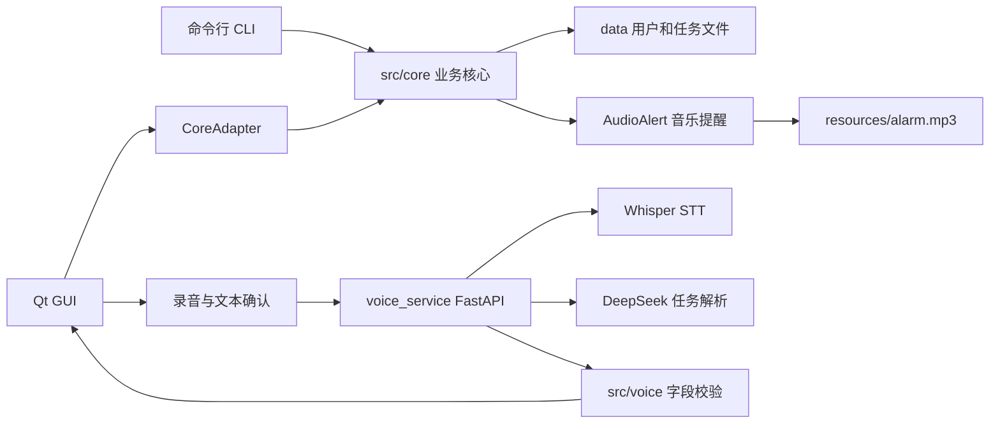
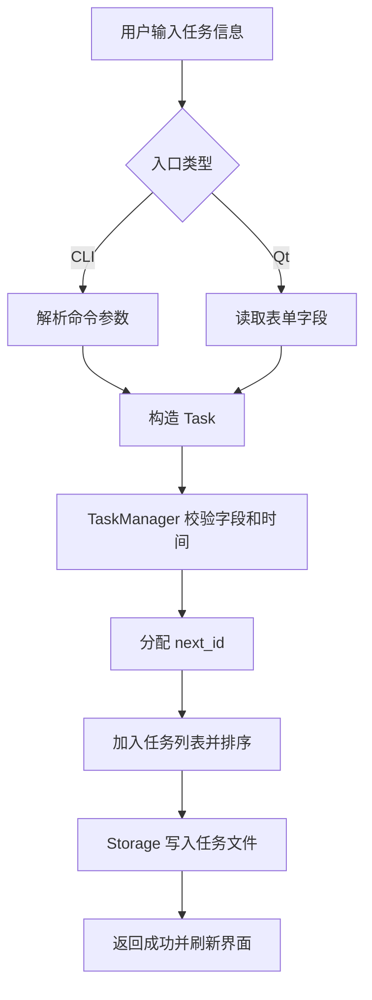

# MySchedule 设计文档

## 1. 小组成员与分工

本项目小组成员为林致铮、汪卓锐。项目采用“核心业务先行、交互入口复用 Core、语音和提醒独立集成”的方式协作。

| 成员 | GitHub 记录 | 主要分工 |
|---|---|---|
| 林致铮 | `zzlin200706` 创建并合并 PR #2、#3、#5、#7、#8，完成项目初始化和后期文档整理 | C++17/CMake 项目骨架、账号注册登录、任务增删改查、CLI 交互、持久化、Qt 图形界面、最终集成与文档 |
| 汪卓锐 | `zrrrr-666` 创建 PR #4、#6、#9，其中 #6 和 #9 已合并 | 音乐提醒、提醒线程修复、共享音频播放、语音识别服务、DeepSeek 任务解析、Qt 语音入口集成 |

林致铮主要负责 `Task`、`UserManager`、`Storage`、`TaskManager` 等核心模块，以及 CLI、Qt 登录注册窗口、主窗口、任务表单、删除/修改任务和提醒弹窗。汪卓锐主要负责 `resources/alarm.mp3`、到期提醒查询接口、提醒状态更新、`AudioAlert` 音频模块，以及 FastAPI、Whisper、DeepSeek 和 Qt 语音添加任务流程。

## 2. 项目概述与运行界面

`MySchedule` 是一个面向 Linux 的本地日程管理系统，使用 C++17、CMake 和 Qt5 Widgets 开发。系统提供命令行界面和图形界面，支持注册登录、添加任务、修改任务、删除任务、按全部/日期/月查询任务、到期提醒和音乐播放。可选语音助手支持用户录音描述任务，由本地 Python 服务完成语音识别，并调用 DeepSeek 将自然语言解析为结构化任务字段。

项目的核心目标是让 CLI、Qt GUI、提醒模块和语音助手围绕同一个任务模型工作，避免不同入口之间出现数据格式和业务规则不一致的问题。运行截图见 `docs/cli.png` 和 `docs/tui.png`。

## 3. 总体架构设计

项目采用分层结构。入口层负责用户交互，Core 层负责业务规则和数据持久化，语音服务层负责 AI 能力。CLI 和 Qt GUI 都不直接操作任务文件，而是通过同一套 Core 模块完成业务操作。



这种设计让核心业务集中在 `src/core/`，CLI 和 GUI 只负责不同交互形式。语音助手不直接写入任务文件，而是将解析结果回填到 Qt 表单，由用户确认后再通过原有添加任务流程保存。

## 4. 模块与类设计

| 模块 | 路径 | 职责 |
|---|---|---|
| Core 核心层 | `src/core/` | 账号、任务、时间、存储、提醒、音频播放 |
| CLI 入口 | `src/cli/` | 参数解析、交互式运行、终端输出 |
| Qt 前端 | `Frontend/` | 登录注册、任务列表、日期筛选、任务表单、提醒弹窗、语音入口 |
| GUI 适配层 | `Frontend/src/core_adapter.cpp` | 在 Qt 类型和 Core 类型之间转换 |
| 语音校验层 | `src/voice/` | 定义语音解析结果，并对 AI 返回字段做 C++ 侧校验 |
| 本地语音服务 | `voice_service/` | FastAPI、Whisper 语音识别、DeepSeek 字段解析 |
| 资源与数据 | `resources/`、`data/` | 提醒音频、本地用户和任务数据 |

核心类中，`Task` 表示任务数据，包含 ID、名称、开始时间、优先级、分类、提醒时间和是否已提醒等字段，并负责字段校验、序列化和反序列化。`TaskManager` 是任务业务中心，负责加载任务、添加、修改、删除、按日/月查询、生成任务 ID、排序和收集到期提醒。`Storage` 统一管理 `data/users.txt` 和 `data/tasks_<username>.txt` 的读写，保存 `next_id` 元数据防止任务 ID 被复用。`UserManager` 负责注册、登录、用户名校验、salt 生成和密码 Hash 校验。`Reminder` 负责 CLI 后台提醒线程，`AudioAlert` 封装提醒音频路径、播放能力检查和异步播放。

Qt 侧的 `CoreAdapter` 是 GUI 和 Core 的边界，负责 `QString`、前端任务结构和 Core `Task` 之间的转换。`LoginWindow`、`RegisterWindow` 和 `MainWindow` 分别负责登录、注册和主界面。语音侧的 `ParsedTaskData`、`VoiceResult` 和 `TaskDataValidator` 负责承接 AI 服务返回结果，并在进入 Core 前进行合法性校验。

## 5. 主要流程设计

### 5.1 添加任务流程



查询任务流程：用户选择全部、指定日期或指定月份，`TaskManager` 过滤任务并按开始时间排序，最后由 CLI 输出表格或由 Qt 刷新表格。删除和修改任务同样先由入口层解析输入，再交给 `TaskManager` 校验 ID、修改内存列表并通过 `Storage` 保存。

### 5.2 提醒与语音流程

```mermaid
flowchart TD
    R1[CLI 后台线程或 Qt 定时器] --> R2[检查 remindTime <= 当前时间且未提醒]
    R2 --> R3[标记 reminded = true]
    R3 --> R4[保存提醒状态]
    R4 --> R5[文字/弹窗提醒]
    R5 --> R6[AudioAlert 播放 alarm.mp3]

    V1[用户点击录音] --> V2[arecord 生成 WAV]
    V2 --> V3[voice_service /stt]
    V3 --> V4[Whisper 返回识别文本]
    V4 --> V5[用户确认文本]
    V5 --> V6[/parse-task 调用 DeepSeek]
    V6 --> V7[src/voice 校验字段]
    V7 --> V8[回填 Qt 表单]
    V8 --> V9[复用普通添加流程保存]
```

## 6. 关键技术问题

多入口共享 Core 是项目最重要的设计点。CLI 和 Qt GUI 如果分别实现任务管理，容易出现时间校验、排序、文件格式和提醒状态不一致。因此所有账号、任务、存储、时间和提醒规则都集中在 `src/core/`，GUI 只通过 `CoreAdapter` 调用 Core。

本地持久化需要处理写入失败、文件损坏和任务 ID 复用。项目统一使用 `Storage` 管理路径和读写格式，任务文件保存 `next_id` 元数据，并采用临时文件写入后替换旧文件的方式降低写入中断风险。

日程系统依赖准确的时间处理。项目统一使用 `YYYY-MM-DD HH:MM` 格式，添加和修改任务时校验开始时间、提醒时间、优先级和分类；查询时支持全部、指定日期和指定月份，并按真实开始时间排序。

后台提醒不能阻塞用户操作。CLI 使用后台线程，Qt 使用定时器；任务被提醒后立即更新 `reminded` 状态并保存，避免程序重启后重复提醒。音乐提醒下沉到 `AudioAlert`，CLI 和 GUI 都能复用同一套音频路径查找、播放检查和异步播放逻辑。

语音识别和自然语言解析依赖 Python、Whisper 和 DeepSeek API。为降低 C++/Qt 构建复杂度，AI 能力放在本地 FastAPI 服务中，Qt 负责录音、上传和结果展示。AI 返回结果不会直接写入任务文件，而是先经过 C++ 侧校验并回填表单，最后由用户确认保存。

## 7. 构建与运行

CLI 构建与运行：

```bash
cmake -S . -B build
cmake --build build -j
./build/myschedule run
```

Qt GUI 构建与运行：

```bash
cmake -S Frontend -B Frontend/build
cmake --build Frontend/build -j
./Frontend/ScheduleManagerGUI
```

语音服务运行：

```bash
cd voice_service
python3 -m venv .venv
source .venv/bin/activate
pip install -r requirements.txt
cp .env.example .env
uvicorn app:app --host 127.0.0.1 --port 8765
```

## 8. 总结

本项目以 `TaskManager` 为中心，把任务模型、文件存储、时间校验和提醒状态统一到 Core 层，并让 CLI、Qt GUI、音乐提醒和语音助手复用同一套业务规则。分层设计解决了多入口一致性、本地持久化可靠性、后台提醒、音频播放复用和 AI 语音服务集成等关键问题。
