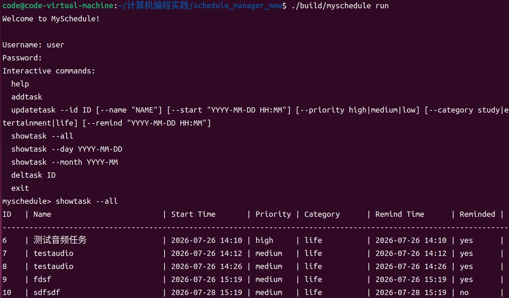
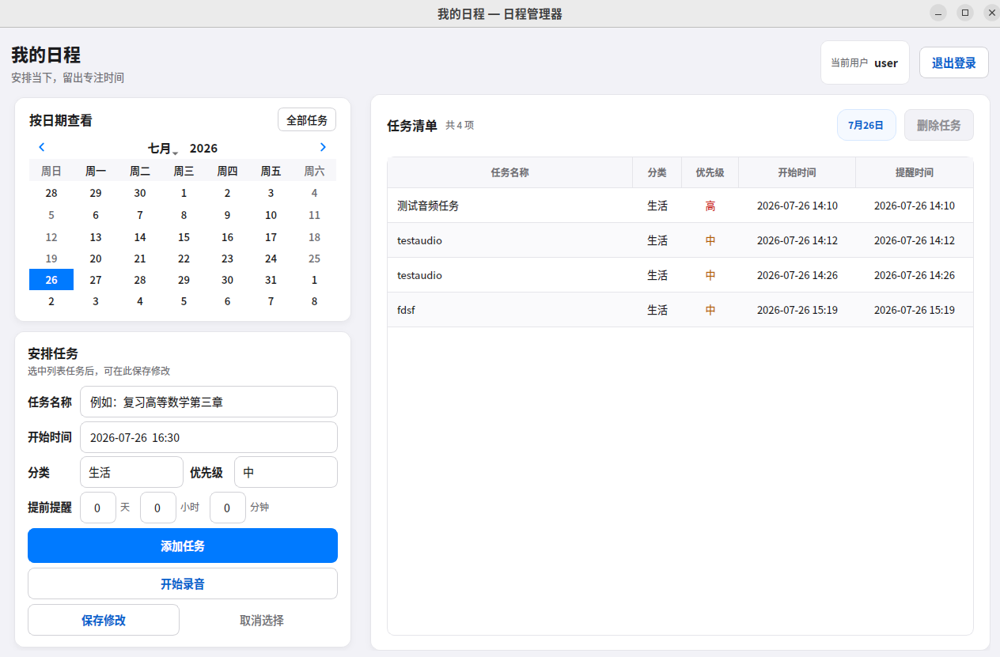

# MySchedule 设计文档

## 1. 小组成员与分工

本项目小组成员为林致铮、汪卓锐。分工依据 GitHub PR 与提交历史划分，整体采用“核心业务先行、交互入口复用 Core、语音和提醒独立集成”的协作方式。

| 成员 | GitHub 记录 | 主要分工 |
|---|---|---|
| 林致铮 | `zzlin200706` 创建并合并 PR #2、#3、#5、#7、#8，并完成项目初始化和后期文档整理 | 项目骨架、CMake 构建、账号注册登录、任务核心管理、CLI 交互流程、持久化加固、Qt 图形界面、最终集成与文档 |
| 汪卓锐 | `zrrrr-666` 创建 PR #4、#6、#9，其中 #6 和 #9 已合并 | 音乐提醒、提醒线程修复、提醒音频资源、共享音频播放模块、语音识别服务、DeepSeek 任务解析、Qt 语音入口集成 |

具体分工如下：

- 林致铮负责建立 C++17/CMake 项目结构，完成 `Task`、`UserManager`、`Storage`、`TaskManager` 等核心模块，使 CLI 与 Qt GUI 能够共享同一套账号、任务、时间校验和数据持久化逻辑。
- 林致铮负责命令行程序，包括注册登录流程、交互式 `run` 模式、直接命令模式、任务增删改查、按日/月/全部查询和终端输出格式。
- 林致铮负责持久化可靠性，包括用户文件、任务文件、`next_id` 元数据、临时文件写入和异常数据拒绝，避免任务 ID 重复和文件损坏导致的数据错误。
- 林致铮负责 Qt 主体界面，包括登录注册窗口、主窗口、任务列表、日期筛选、任务表单、删除/修改任务和提醒弹窗。
- 汪卓锐负责音乐提醒和提醒线程相关功能，包括 `resources/alarm.mp3`、到期提醒查询接口、提醒线程修复，以及提醒触发时的音频播放。
- 汪卓锐负责语音助手功能，包括 Python FastAPI 本地服务、Whisper 语音转文字、DeepSeek 自然语言任务解析、C++ 侧语音结果校验，以及 Qt 中录音、确认和表单回填流程。

## 2. 项目概述

`MySchedule` 是一个面向 Linux 的本地日程管理系统，使用 C++17、CMake 和 Qt5 Widgets 开发。项目同时提供命令行界面和图形界面，支持用户注册登录、任务添加、修改、删除、查询、提醒和音乐播放。项目还提供可选语音助手：用户可以录音描述任务，由本地 Python 服务完成语音识别，并调用 DeepSeek 将自然语言解析为结构化任务字段。

项目的核心设计目标是让 CLI、Qt GUI、提醒模块和语音助手围绕同一个任务模型工作，避免不同入口之间出现数据格式和业务规则不一致的问题。

## 3. 运行界面截图

项目运行界面包括命令行交互界面和 Qt 图形界面。命令行界面支持登录、交互式命令和表格化任务输出；Qt 图形界面支持日期筛选、任务列表、任务编辑、删除任务和语音录入。

<table>
  <tr>
    <td align="center"><strong>CLI 交互界面</strong></td>
    <td align="center"><strong>Qt 图形界面</strong></td>
  </tr>
  <tr>
    <td></td>
    <td></td>
  </tr>
</table>

## 4. 总体架构设计

项目采用分层结构。入口层负责用户交互，Core 层负责业务规则和数据持久化，语音服务层负责 AI 能力。整体架构如下：

```text
CLI
  -> src/cli
  -> src/core
  -> data/

Qt GUI
  -> Frontend
  -> CoreAdapter
  -> src/core
  -> data/

Qt Voice Assistant
  -> arecord 本地录音
  -> voice_service FastAPI
  -> faster-whisper STT
  -> DeepSeek 任务字段解析
  -> src/voice 校验
  -> Qt 任务表单
```

这种设计让核心业务集中在 `src/core/`，CLI 和 GUI 只负责不同的交互方式。语音助手不直接写入任务文件，而是将解析结果回填到 Qt 表单，由用户确认后再通过原有添加任务流程保存。

## 5. 模块设计

| 模块 | 路径 | 职责 |
|---|---|---|
| Core 核心层 | `src/core/` | 账号、任务、时间、存储、提醒、音频播放 |
| CLI 入口 | `src/cli/` | 命令行参数解析、交互式运行、终端输出 |
| Qt 前端 | `Frontend/` | 登录注册、任务列表、日期筛选、任务表单、提醒弹窗、语音入口 |
| GUI 适配层 | `Frontend/src/core_adapter.cpp` | 在 Qt 类型和 Core 类型之间转换，封装 GUI 对 Core 的调用 |
| 语音校验层 | `src/voice/` | 定义语音解析结果，并对 AI 返回字段进行 C++ 侧校验 |
| 本地语音服务 | `voice_service/` | FastAPI 服务、Whisper 语音识别、DeepSeek 字段解析 |
| 资源文件 | `resources/` | 提醒音频 `alarm.mp3` |
| 数据目录 | `data/` | 本地用户和任务数据 |

## 6. 类设计

### 6.1 核心类

`Task` 是任务数据结构，包含任务 ID、名称、开始时间、优先级、分类、提醒时间和是否已提醒等字段。它还提供字段合法性校验、序列化和反序列化能力。

```text
Task
  id
  name
  startTime
  priority
  category
  remindTime
  reminded
```

`TaskManager` 是项目最重要的业务中心。它负责加载任务、添加任务、修改任务、删除任务、按日期或月份查询任务、生成任务 ID、排序任务和收集到期提醒。CLI 和 Qt GUI 的任务操作最终都会落到 `TaskManager`。

```text
TaskManager
  load()
  addTask()
  updateTask()
  deleteTaskById()
  getAllTasks()
  getTasksByDay()
  getTasksByMonth()
  collectDueReminders()
```

`Storage` 负责本地文件读写。用户数据保存在 `data/users.txt`，每个用户的任务保存在独立的 `data/tasks_<username>.txt`。保存任务时同时保存 `next_id` 元数据，防止删除任务后 ID 被复用。

`UserManager` 负责账号管理，包括用户注册、登录、用户名校验、salt 生成和密码 Hash 校验。

`Reminder` 负责 CLI 后台提醒线程。它周期性调用 `TaskManager::collectDueReminders()`，发现到期任务后触发回调并保存 `reminded` 状态。

`AudioAlert` 负责音乐提醒。该模块封装提醒音频路径、播放能力检查、同步播放和异步播放，使 CLI 与 Qt GUI 能够复用同一套音频提醒逻辑。

### 6.2 Qt 相关类

`CoreAdapter` 是 Qt GUI 和 Core 之间的边界。GUI 中使用 `QString` 和前端任务结构，Core 中使用标准 C++ 字符串和 `Task`，因此需要通过 `CoreAdapter` 完成类型转换和错误信息转换。

`LoginWindow`、`RegisterWindow` 和 `MainWindow` 分别负责登录、注册和主界面。主界面中包含日历筛选、任务表格、任务编辑表单、提醒弹窗和语音录入按钮。

### 6.3 语音相关类与服务

`src/voice/` 中的 `ParsedTaskData`、`VoiceResult` 和 `TaskDataValidator` 负责承接 AI 服务返回的数据，并在进入 Core 前进行校验。

`voice_service/` 是本地 Python 服务，主要接口包括：

- `GET /health`：检查服务、Whisper 模型和 DeepSeek API Key 状态；
- `POST /stt`：接收 WAV 文件并转写为文本；
- `POST /parse-task`：调用 DeepSeek，将自然语言解析为任务字段。

## 7. 主要流程设计

### 7.1 添加任务流程

```text
用户输入任务信息
  -> CLI 参数解析或 Qt 表单读取
  -> 构造 Task
  -> TaskManager 校验任务字段和时间冲突
  -> 分配 next_id
  -> 加入任务列表并排序
  -> Storage 写入 data/tasks_<username>.txt
  -> 返回成功信息并刷新界面
```

### 7.2 查询任务流程

```text
用户选择查询方式
  -> 全部任务 / 指定日期 / 指定月份
  -> TaskManager 过滤任务
  -> 按开始时间排序
  -> CLI 表格输出或 Qt 表格刷新
```

### 7.3 提醒流程

```text
CLI 后台线程或 Qt 定时器触发
  -> TaskManager 检查 remindTime <= 当前时间且 reminded == false 的任务
  -> 标记任务 reminded = true
  -> Storage 保存提醒状态
  -> CLI 输出文字提醒或 Qt 显示非模态弹窗
  -> AudioAlert 异步播放 resources/alarm.mp3
```

### 7.4 语音添加任务流程

```text
用户点击开始录音
  -> Qt 调用 arecord 生成 WAV 文件
  -> 上传到 voice_service /stt
  -> Whisper 返回识别文本
  -> 用户确认文本
  -> 调用 /parse-task 请求 DeepSeek 解析字段
  -> Qt 接收结构化结果
  -> src/voice 校验字段合法性
  -> 自动回填任务表单
  -> 用户点击添加任务
  -> 复用普通添加任务流程保存
```

## 8. 关键技术问题说明

### 8.1 多入口共享 Core 业务逻辑

项目同时有 CLI 和 Qt GUI。如果两个入口分别实现任务管理，容易出现时间校验、任务排序、数据文件格式和提醒状态不一致的问题。因此项目将核心业务集中在 `src/core/`，CLI 直接调用 Core，Qt 通过 `CoreAdapter` 调用 Core。这样可以保证不同入口使用统一的数据模型和业务规则。

### 8.2 本地持久化和任务 ID 可靠性

项目使用本地文本文件保存账号和任务。关键问题是写入失败、文件损坏和任务 ID 复用。项目通过 `Storage` 统一管理文件路径和读写格式，任务文件中保存 `next_id` 元数据，使任务 ID 单调递增。保存任务时采用临时文件写入和替换方式，降低写入中断导致文件损坏的风险。

### 8.3 时间校验、查询和排序

日程系统依赖准确的时间处理。项目统一使用 `YYYY-MM-DD HH:MM` 格式，添加和修改任务时校验开始时间、提醒时间、优先级和分类。查询时支持全部、指定日期和指定月份三种方式，并按真实开始时间排序，保证 CLI 和 GUI 中显示顺序一致。

### 8.4 后台提醒与状态持久化

提醒功能需要周期性检查任务，但不能阻塞用户操作。CLI 使用后台线程，Qt 使用定时器。到期任务被提醒后会立即更新 `reminded` 状态并保存，避免程序重启后重复提醒。多个任务在同一轮检查中到期时，音频提醒统一播放一次，避免重复启动播放器。

### 8.5 音频提醒复用

音乐提醒最初可以只服务某个入口，但项目最终需要 CLI 和 GUI 都能使用。因此音频播放逻辑被下沉到 `AudioAlert`，统一管理 `resources/alarm.mp3` 的路径、播放检查和异步播放。这样提醒模块和 GUI 都可以复用同一套音频能力。

### 8.6 语音识别服务边界

语音识别和自然语言解析依赖 Python、Whisper 和 DeepSeek API。如果直接写入 C++ GUI，会增加构建复杂度和耦合度。因此项目将 AI 能力放在本地 FastAPI 服务中，Qt 只负责录音、上传和结果展示。AI 返回的结构化字段不会直接写入任务文件，而是先经过 C++ 侧校验并回填表单，最后由用户确认保存。

### 8.7 本地服务安全和配置管理

语音服务默认绑定 `127.0.0.1`，避免暴露到公网。DeepSeek API Key 保存在本地 `.env` 文件中，不提交到 Git。`/health` 接口只返回服务状态，不泄露密钥。临时录音文件在识别后删除，减少本地隐私数据残留。

## 9. 构建与运行

CLI 构建方式：

```bash
cmake -S . -B build
cmake --build build -j
./build/myschedule run
```

Qt GUI 构建方式：

```bash
cmake -S Frontend -B Frontend/build
cmake --build Frontend/build -j
./Frontend/ScheduleManagerGUI
```

语音服务运行方式：

```bash
cd voice_service
python3 -m venv .venv
source .venv/bin/activate
pip install -r requirements.txt
cp .env.example .env
uvicorn app:app --host 127.0.0.1 --port 8765
```

## 10. 总结

本项目的核心是以 `TaskManager` 为中心的 Core 层。它连接任务模型、文件存储、时间校验和提醒状态，是 CLI、Qt GUI 和语音助手最终复用的业务基础。项目通过模块分层解决了多入口一致性、本地持久化可靠性、后台提醒、音频播放复用和 AI 语音服务集成等关键问题。
